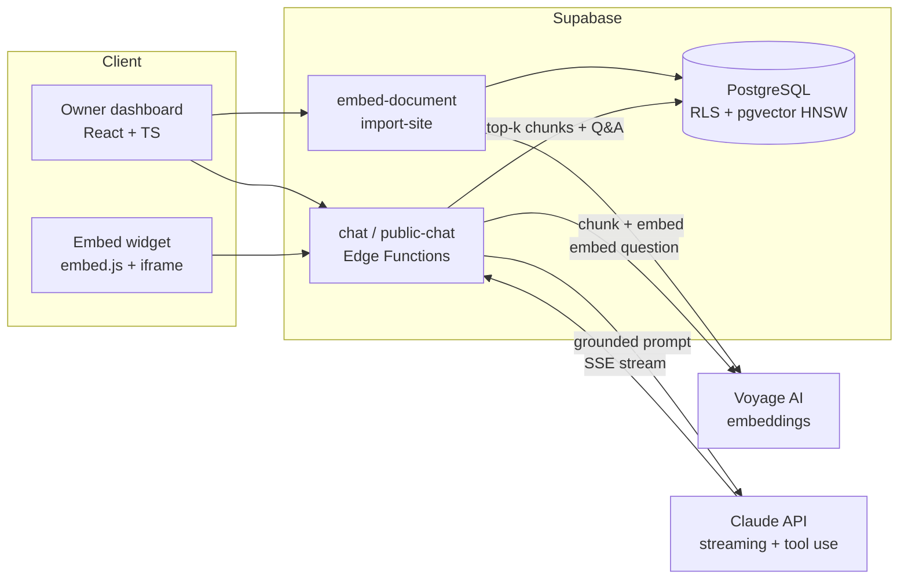

# ChatBotKur

**AI customer-support chatbots for Turkish small businesses — set up in minutes, no code.**

Cafés, hair salons and online shops create a bot, feed it their menu, price list or website, and embed it on their site with one line of code. Customers chat anonymously; the bot answers from the business's own content, cites its sources, refuses to make things up, and hands real requests (call-backs, appointments) to the owner.

🔗 **Live:** [chatbot-kur.vercel.app](https://chatbot-kur.vercel.app)

<!-- TODO: add a 10–15 s GIF here: upload a menu → ask "Pazartesi açık mısınız?" → answer with source -->
<!--  -->

---

## Highlights

- **Retrieval-augmented answers (RAG)** — businesses upload text, PDFs or simply paste their website URL; the bot answers from that content and shows which document it used.
- **Measured, not guessed** — built a 36-question Turkish evaluation set (+106 off-topic / cross-tenant questions). Switching to heading-aware chunking raised retrieval hit rate from **67% → 97%** with **0 false matches**.
- **Learns what it doesn't know** — unanswered questions are grouped by meaning and surfaced to the owner, who can turn them into a Q&A entry with one click.
- **Tool use with server-side guardrails** — the bot can capture call-back requests, but a record is only written after the server verifies the customer's own details, a shown privacy (KVKK) notice and an explicit "yes". The model alone can never trigger it.
- **Multi-tenant by design** — every business sees only its own bots, documents and requests, enforced in PostgreSQL Row Level Security and verified with cross-tenant tests.
- **Security-minded** — SSRF protection for website import (private IPs, metadata endpoints, redirects), prompt-injection hardening for uploaded content, PII masking, automatic data retention (90 / 180 days).

## Features

| Area | What it does |
|---|---|
| Bot management | Create / edit / soft-delete bots, Q&A pairs, business contact info, working hours |
| Knowledge base | Paste text, upload `.txt` / PDF (parsed in the browser), import up to 30 pages from a website, re-crawl, remove |
| Chat | Streaming answers (SSE), Q&A takes priority over documents, sources shown in the owner's test chat |
| Widget | One `<script>` tag adds a floating chat button to any site; anonymous, rate-limited |
| Requests | Customers leave call-back requests after explicit consent; owner manages them in a "Talepler" inbox |
| Insights | "Unanswered questions" grouped by meaning, ranked by frequency |

## Architecture



**How a question is answered**
1. The question is embedded (Voyage, 1024-dim) and matched against the bot's own chunks with cosine similarity (HNSW index); low-similarity chunks are dropped.
2. Q&A pairs and retrieved chunks are added to the prompt — documents are marked as *data*, never as instructions.
3. Claude streams the answer back over SSE. If nothing relevant was found, the bot says so and the question is logged for the owner.
4. If the customer asks to be contacted, the bot may call the `create_lead` tool; the server validates consent before saving.

## Tech stack

- **Frontend:** React, TypeScript (strict), Vite, Tailwind CSS, Radix UI
- **Backend:** Supabase — PostgreSQL, Row Level Security, Auth, Edge Functions (Deno), pg_cron
- **AI:** Anthropic Claude (streaming, tool use), Voyage AI embeddings, pgvector
- **Deploy:** Vercel (frontend), Supabase (database + functions)

## Engineering notes

A few problems that shaped the design:

- **The bot repeated the customer's phone number as the business's number.** A prompt rule meant to stop false promises caused it. Fixed by giving businesses structured contact fields and having the server — not the model — append the redirect sentence.
- **A default fallback message taught the bot to make promises** ("I'll forward this to the team"). Lesson: templates and defaults shape model behaviour as much as the system prompt.
- **Grouping unanswered questions by keywords failed in Turkish** ("köpek", "köpekler", "köpeğimle"). Switched to meaning-based grouping; embeddings are computed from the PII-masked text.
- **Migrations had drifted** after manual SQL in the dashboard. Repaired the migration history so every schema change now goes through `supabase db push`.

## Local setup

**Prerequisites:** Node.js 18+, Supabase CLI, an Anthropic API key and a Voyage AI API key.

```bash
git clone https://github.com/erenguler1/chatbot-kur.git
cd chatbot-kur
npm install
cp .env.local.example .env.local   # fill VITE_SUPABASE_URL and VITE_SUPABASE_ANON_KEY

supabase link --project-ref <your-ref>
supabase db push
supabase secrets set ANTHROPIC_API_KEY=... VOYAGE_API_KEY=...

supabase functions deploy chat
supabase functions deploy embed-document
supabase functions deploy import-site
supabase functions deploy public-chat --no-verify-jwt
supabase functions deploy public-get-messages --no-verify-jwt

npm run dev
```

> `vercel.json` contains the SPA rewrite; without it, refreshing a route like `/bots/:id` returns 404 on Vercel.

### Embed on any website

```html
<script src="https://chatbot-kur.vercel.app/embed.js?botId=YOUR_BOT_ID"></script>
```

## Roadmap

- [x] Phase 1 — auth, bots, Q&A, streaming chat, embeddable widget
- [x] RAG v0.1–v0.3 — documents, PDF, website import, evaluation set, unanswered-question insights
- [x] Tool use v0.1 — consent-verified call-back requests
- [ ] Appointment requests + "are you open now?" (working hours)
- [ ] Hybrid search (semantic + keyword) for paraphrased questions
- [ ] Image understanding, voice, WhatsApp channel, MCP integrations

## Author

**Eren Güler** — Computer Engineering, Eskişehir Osmangazi University
[GitHub](https://github.com/erenguler1) · [LinkedIn](https://www.linkedin.com/in/eren-guler1)
